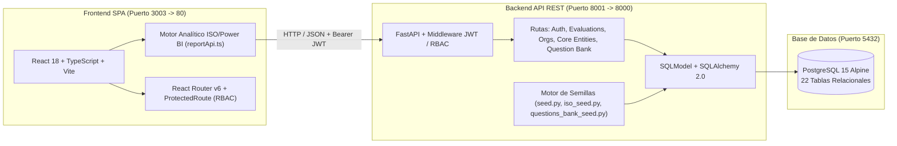
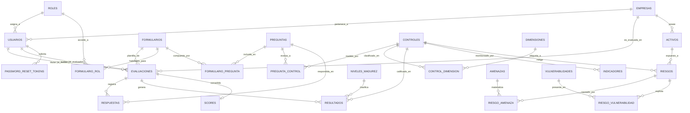

# Documentación Técnica, Arquitectónica y Normativa del MVP de Evaluación de Madurez en Ciberseguridad (ISO/IEC 27001:2022)

> **Propósito de este documento**: Servir como memoria técnica, metodológica y funcional integral del proyecto **MVP-CIBERSECURITY** para el equipo encargado de redactar y formalizar el documento de Tesis / Trabajo de Grado. Contiene la evolución del desarrollo, la arquitectura de software, el modelo de base de datos, el sustento matemático y normativo (ISO/IEC 27001:2022, ISO/IEC 27002:2022, ISO/IEC 27004:2016, NIST CSF 2.0 y OSINT 2019), el desglose del banco de preguntas multinivel y el análisis detallado página por página de la aplicación.

---

## Índice General

1. [Resumen Ejecutivo y Objetivo del Sistema](#1-resumen-ejecutivo-y-objetivo-del-sistema)
2. [Evolución Cronológica del Desarrollo del MVP](#2-evolución-cronológica-del-desarrollo-del-mvp)
3. [Arquitectura del Sistema y Stack Tecnológico](#3-arquitectura-del-sistema-y-stack-tecnológico)
4. [Modelo de Datos Relacional (Esquema de 22 Tablas ORM)](#4-modelo-de-datos-relacional-esquema-de-22-tablas-orm)
5. [Marco Teórico y Fundamentación Normativa (Sustento para Tesis)](#5-marco-teórico-y-fundamentación-normativa-sustento-para-tesis)
   - 5.1. Origen de las 30 Dimensiones ISO (`ISO/IEC 27002:2022` Cláusula 4.2)
   - 5.2. Los 4 Capítulos del Anexo A (`ISO/IEC 27001:2022`) y los 18 Dominios Temáticos
   - 5.3. Modelo Matemático de Puntuación, Pesos y Normalización Psicométrica (`ISO/IEC 27004:2016`)
   - 5.4. Niveles de Madurez CMMI (Escala 1 a 5)
   - 5.5. Integración de Vectores OSINT 2019 e Ingeniería Social (Control `A.5.7`)
6. [Arquitectura de Roles, Banco de Preguntas y Cuestionarios Multinivel](#6-arquitectura-de-roles-banco-de-preguntas-y-cuestionarios-multinivel)
   - 6.1. Modelo de Control de Acceso Basado en Roles (RBAC)
   - 6.2. Estructura del Banco de Preguntas (104 Preguntas Únicas / 112 Aplicadas)
   - 6.3. Las 8 Preguntas Espejo (`tec_est`): Detector de Brecha Alta Dirección vs. Realidad TI
   - 6.4. Semillas de Datos (`seed.py`) y Credenciales de Demostración
7. [Catálogo Detallado Página por Página (Frontend React + TypeScript)](#7-catálogo-detallado-página-por-página-frontend-react--typescript)
   - 7.1. Módulo de Autenticación y Acceso Público
   - 7.2. Módulo de Inicio y Paneles de Control (Dashboards Operativos)
   - 7.3. Módulo de Gobierno y Parametrización Normativa (Admin)
   - 7.4. Módulo de Gestión de Organizaciones, Activos y Vulnerabilidades
   - 7.5. Módulo de Banco de Preguntas y Plantillas de Formularios
   - 7.6. Módulo de Asignación y Flujo de Ejecución de Evaluaciones
   - 7.7. Módulo de Reportes Ejecutivos e Imprimibles
   - 7.8. Módulo de Inteligencia Analítica Estilo Power BI (`/results-dashboard`)
8. [Sustentación Científica y Normativa del Dashboard Analítico Estilo Power BI](#8-sustentación-científica-y-normativa-del-dashboard-analítico-estilo-power-bi)
9. [Contrato de la API REST (Endpoints del Backend FastAPI)](#9-contrato-de-la-api-rest-endpoints-del-backend-fastapi)
10. [Sistema de Diseño Visual, Modo Oscuro/Claro y Accesibilidad](#10-sistema-de-diseño-visual-modo-oscuroclaro-y-accesibilidad)
11. [Infraestructura Docker y Pruebas de Rendimiento / Seguridad](#11-infraestructura-docker-y-pruebas-de-rendimiento--seguridad)

---

## 1. Resumen Ejecutivo y Objetivo del Sistema

**MVP-CIBERSECURITY** es una plataforma web integral para diagnosticar, medir, auditar y visualizar el **nivel de madurez en seguridad de la información y ciberseguridad** de organizaciones de cualquier sector y tamaño.

A diferencia de las herramientas tradicionales que aplican un único cuestionario plano a un solo interlocutor (lo que introduce sesgos de autocomplacencia o desconocimiento técnico), este MVP implementa un **Modelo de Evaluación Triangulada de 360° en Tres Niveles Organizacionales**:
1. **Nivel Bajo (`user_nivel_bajo` — Operativo / Colaboradores)**: Evalúa la cultura real, higiene digital cotidiana, escritorio limpio, prevención de phishing/vishing, manejo de contraseñas y dispositivos en el puesto de trabajo.
2. **Nivel Medio (`user_nivel_medio` — Técnico / TI y Sistemas)**: Evalúa la implementación real de controles tecnológicos, arquitectura de red, segmentación VLAN, IAM/PAM, MFA, gestión de parches, EDR, SIEM, respaldos 3-2-1, criptografía y seguridad cloud.
3. **Nivel Alto (`user_nivel_alto` — Estratégico / Alta Dirección y C-Level)**: Evalúa el gobierno del SGSI, liderazgo, apetito de riesgo, presupuesto, cumplimiento legal (Habeas Data / GDPR), Declaración de Aplicabilidad (SoA), continuidad de negocio (BCP/DRP) y gestión de proveedores.

Los resultados recolectados se procesan mediante un **motor analítico alineado con ISO/IEC 27001:2022, ISO/IEC 27002:2022, ISO/IEC 27004:2016, NIST CSF 2.0 y OSINT 2019**, presentándose en un **Centro de Inteligencia Analítica interactivo estilo Power BI** que permite filtrar en tiempo real tanto una evaluación individual como el consolidado 360° de todos los miembros evaluados de una misma entidad.

---

## 2. Evolución Cronológica del Desarrollo del MVP

El desarrollo del proyecto se ejecutó en **seis fases iterativas** claramente trazables en el historial del repositorio Git:

| Fase | Hito de Ingeniería | Descripción Técnica de lo Construido |
| :--- | :--- | :--- |
| **Fase 1** | **Cimientos y Arquitectura Limpia** | Diseño de la estructura separada en capas (`domain`, `application`, `infraestructure`, `interfaces`) en Python con FastAPI y SQLModel, junto con el cliente SPA en React + TypeScript + Vite. Creación de los flujos base de autenticación JWT (`/auth/token`), registro (`/auth/register`) y recuperación de contraseña con tokens opacos hasheados (`PasswordResetTokenORM`). |
| **Fase 2** | **Gestión de Entidades Nucleares y Flujo de Evaluación** | Implementación del CRUD completo de Organizaciones (`empresas`), Usuarios (`usuarios`), Evaluaciones (`evaluaciones`), Asignaciones Evaluador-Empresa (`/asignaciones`) y el flujo interactivo de respuesta con autoguardado controlado (`EvaluationWorkflowPage.tsx`). |
| **Fase 3** | **Pruebas de Carga, Estrés, Seguridad y Responsividad** | Ejecución de suites de prueba con k6/scripts en `performance-tests/` (`load-test.js`, `stress-test.js`, `security-test.js`, `login-validation-test.js`). Optimización de tablas responsivas (`.table-responsive`), políticas de contraseñas robustas y configuración de contenedores Docker y Nginx. |
| **Fase 4** | **Arquitectura de las 30 Dimensiones ISO 27002:2022 y Roles Dinámicos** | Incorporación de la taxonomía moderna de atributos de `ISO/IEC 27002:2022` (30 dimensiones en 5 categorías), relación muchos-a-muchos con Controles ISO (`control_dimension`), relación muchos-a-muchos entre Formularios y Roles (`formulario_rol`) y el generador automático de formularios aleatorios muestreados por dimensión (`/questionnaires/generate-random`). |
| **Fase 5** | **Reestructuración del Banco de Preguntas en 3 Niveles (104 Preguntas)** | Creación del banco maestro en `questions_bank_seed.py` con 104 preguntas únicas de alta precisión técnica, ponderadas por criticidad (`peso 1.0, 0.7, 0.4`), distribuidas en 3 cuestionarios especializados (General, Técnico y Estratégico) e incluyendo 8 preguntas compartidas (`tec_est`) entre TI y Dirección. |
| **Fase 6** | **Centro de Inteligencia Analítica Power BI (`/results-dashboard`) y Semillas 360°** | Construcción del motor de clasificación normativa en `reportApi.ts` y la vista interactiva `ResultsDashboardPage.tsx` con filtrado cruzado en vivo (Cross-Filtering), radar pentagonal NIST CSF, ranking completo de los 18 dominios ISO 27001, análisis de exposición OSINT 2019, Espejo de Percepción Directiva vs. TI, sustentación de auditoría ("Lo Bueno y Lo Malo"), matriz detallada ordenable/filtrable por columna, soporte nativo para Modo Oscuro y semillas de 3 evaluaciones 100% resueltas en `seed.py`. |

---

## 3. Arquitectura del Sistema y Stack Tecnológico

El sistema sigue una arquitectura **Cliente-Servidor desacoplada** y contenerizada en tres servicios orquestados mediante Docker Compose.

### Stack Tecnológico Detallado

- **Frontend (`Frontend/`)**:
  - **Framework**: React 18.2 con TypeScript 5 y empaquetador Vite 5.4.
  - **Enrutamiento y Seguridad en Cliente**: `react-router-dom` v6.11 con guardián de rutas `ProtectedRoute.tsx` respaldado por la matriz de permisos `roleAccess.ts`.
  - **Visualización de Datos**: Gráficos SVG vectoriales nativos construidos a medida (`NistRadarChart`, barras interactivas de progreso, semáforos Likert y tarjetas comparativas) sin dependencias pesadas externas, garantizando tiempos de carga instantáneos y control total del filtrado cruzado.
  - **Estilos**: Sistema de Tokens CSS nativos (`Frontend/src/styles/theme.css`) con soporte reactivo para **Modo Claro (`.theme-light`)** y **Modo Oscuro (`.theme-dark`)**.
  - **Servidor de Producción**: Imagen multi-stage `node:18-alpine` (build) + `nginx:stable-alpine` (runtime con soporte SPA fallback en `nginx.conf`).

- **Backend (`Backend/py_backend/`)**:
  - **Framework Web**: FastAPI 0.115 sobre servidor ASGI Uvicorn 0.30 (Python 3.11).
  - **ORM y Validación**: SQLModel 0.0.22 (integración de SQLAlchemy 2.0 + Pydantic v2).
  - **Autenticación y Criptografía**: Tokens JWT (`PyJWT` / `python-jose`) firmados con `HS256`, validación estricta de políticas de contraseña (`app/validation.py`) y tokens de recuperación de contraseña con hash SHA-256 de un solo uso.
  - ** Estructura de Capas (Clean Architecture)**:
    - `domain/entities/`: Entidades puras del dominio (`empresa.py`, `evaluacion.py`, `formulario.py`, `pregunta.py`, `respuesta.py`, `control.py`, `activo.py`, `amenaza.py`, `vulnerabilidad.py`, `riesgo.py`, `indicador.py`, `nivel_madurez.py`, `resultado.py`, `score.py`, `rol.py`, `usuario.py`).
    - `application/`: Casos de uso y DTOs (`create_evaluation_use_case.py`, `evaluation_dto.py`).
    - `infraestructure/database/`: Modelos relacionales SQLModel (`models.py`) y repositorios (`sqlalchemy_evaluation_repository.py`).
    - `interfaces/`: Rutas HTTP (`evaluation_routes.py`, `organization_routes.py`, `core_entities_routes.py`, `question_bank_routes.py`, `password_reset_routes.py`) y middleware de autenticación (`auth_middleware.py`).

- **Base de Datos (`db`)**:
  - **Motor**: PostgreSQL 15 (`postgres:15-alpine`) en producción/Docker y soporte híbrido para SQLite (`dev.db`) en pruebas unitarias locales.

---

## 4. Modelo de Datos Relacional (Esquema de 22 Tablas ORM)

El esquema físico de la base de datos está definido en `Backend/py_backend/infraestructure/database/models.py` y consta de **22 tablas** (16 tablas de entidades principales y 6 tablas intermedias `Many-to-Many` para relaciones N:M).

### Diccionario de Tablas de la Base de Datos

| # | Nombre de Tabla SQL | Clase ORM (`models.py`) | Clave Primaria | Descripción y Campos Clave |
| :- | :--- | :--- | :--- | :--- |
| 1 | `roles` | `RolORM` | `id_rol` | Catálogo de roles (`admin`, `evaluator`, `user_nivel_bajo`, `user_nivel_medio`, `user_nivel_alto`). |
| 2 | `usuarios` | `UsuarioORM` | `id_usuario` | Usuarios del sistema: `nombre`, `correo`, `telefono`, `activo`, `password`, `id_rol` (FK), `id_empresa` (FK opcional para staff, obligatoria para usuarios de empresa). |
| 3 | `empresas` | `EmpresaORM` | `id_empresa` | Organizaciones evaluadas: `nombre`, `sector`, `tamano`, `correo`, `nit`, `direccion`, `telefono`. |
| 4 | `formularios` | `FormularioORM` | `id_formulario` | Plantillas de cuestionarios: `nombre`, `descripcion`, `activo`. |
| 5 | `formulario_rol` | `FormularioRolORM` | `(id_formulario, id_rol)` | **Tabla puente N:M** que define qué roles organizacionales pueden responder cada formulario. |
| 6 | `preguntas` | `PreguntaORM` | `id_pregunta` | Banco global de preguntas: `texto`, `peso` (`1.0`, `0.7`, `0.4`), `dimension` (`General` o `Documentación`). |
| 7 | `formulario_pregunta` | `FormularioPreguntaORM` | `(id_formulario, id_pregunta)` | **Tabla puente N:M** que asocia preguntas del banco global a uno o varios formularios. |
| 8 | `dimensiones` | `DimensionORM` | `id_dimension` | Las 30 dimensiones/atributos de `ISO/IEC 27002:2022`: `categoria`, `nombre`, `descripcion`. |
| 9 | `controles` | `ControlORM` | `id_control` | Controles ISO: `nombre`, `descripcion`, `activo`, y planes de remediación por umbral (`rec_alta`, `rec_media`, `rec_baja`). |
| 10 | `control_dimension` | `ControlDimensionORM` | `(id_control, id_dimension)` | **Tabla puente N:M** que etiqueta cada Control ISO con sus atributos de `ISO/IEC 27002:2022`. |
| 11 | `pregunta_control` | `PreguntaControlORM` | `(id_pregunta, id_control)` | **Tabla puente N:M** que vincula preguntas del banco con los Controles ISO que evalúan. |
| 12 | `evaluaciones` | `EvaluacionORM` | `id_evaluacion` | Instancia de evaluación: `fecha`, `estado` (`pendiente`, `en progreso`, `completada`), `id_usuario` (evaluado titular), `id_empresa`, `id_evaluador` (auditor asignado), `id_formulario`, `datos_respuestas` (JSON snapshot) y `creado_en` (UTC). |
| 13 | `respuestas` | `RespuestaORM` | `id_respuesta` | Respuestas individuales por pregunta: `valor` (escala Likert `1..5`), `comentario` (evidencia/hallazgo textual), `id_pregunta` (FK), `id_evaluacion` (FK). |
| 14 | `niveles_madurez` | `NivelMadurezORM` | `id_nivel` | Catálogo de niveles de madurez CMMI (`nivel` 1 a 5, `descripcion`). |
| 15 | `resultados` | `ResultadoORM` | `id_resultado` | Puntaje consolidado por control en una evaluación (`puntaje`, `id_evaluacion`, `id_control`, `id_nivel`). |
| 16 | `scores` | `ScoreORM` | `id_score` | Puntaje global único por evaluación (`valor_total`, `id_evaluacion` UNIQUE). |
| 17 | `indicadores` | `IndicadorORM` | `id_indicador` | Métricas de control SGSI (`nombre`, `formula`, `frecuencia`, `id_control`). |
| 18 | `activos` | `ActivoORM` | `id_activo` | Activos de información de una empresa (`nombre`, `valor`, `id_empresa`). |
| 19 | `riesgos` | `RiesgoORM` | `id_riesgo` | Registro de riesgos (`descripcion`, `impacto`, `probabilidad`, `id_activo`, `id_control`). |
| 20 | `amenazas` | `AmenazaORM` | `id_amenaza` | Catálogo de amenazas (`nombre`). |
| 21 | `vulnerabilidades` | `VulnerabilidadORM` | `id_vulnerabilidad` | Catálogo de vulnerabilidades (`descripcion`). |
| 22 | `password_reset_tokens` | `PasswordResetTokenORM` | `id` | Tokens de recuperación de contraseña de un solo uso (`id_usuario`, `token_hash`, `expires_at`, `used_at`). *(Junto con las tablas puente `riesgo_amenaza` y `riesgo_vulnerabilidad`)*. |

---

## 5. Marco Teórico y Fundamentación Normativa (Sustento para Tesis)

Esta sección documenta de dónde provienen exactamente las dimensiones, controles, fórmulas y categorías del software para su citación directa en el marco teórico y metodológico de la tesis.

### 5.1. Origen de las 30 Dimensiones ISO (`ISO/IEC 27002:2022` Cláusula 4.2)

En la actualización normativa de **ISO/IEC 27001:2022** e **ISO/IEC 27002:2022** (*Information security, cybersecurity and privacy protection — Information security controls*), la norma reemplazó los antiguos 14 dominios de la versión 2013 por **4 capítulos temáticos** y definió en su **Cláusula 4.2 (Tablas de Atributos)** un sistema oficial de **5 tipos de atributos** para clasificar, filtrar y presentar los controles desde diferentes perspectivas de negocio y auditoría.

El archivo [`Backend/py_backend/app/iso_seed.py`](file:///C:/Users/ruthg/Documents/coding/MVP-CIBERSECURITY/Backend/py_backend/app/iso_seed.py) siembra exactamente estos **27 atributos oficiales de ISO/IEC 27002:2022 más 3 dimensiones estructurales/documentales = 30 Dimensiones ISO**:

| Grupo / Categoría en Base de Datos (`DimensionORM.categoria`) | Cantidad | Dimensiones Sembradas (`DimensionORM.nombre`) | Sustento Normativo Exacto |
| :--- | :---: | :--- | :--- |
| **1. Tipo de Control (`Tipo de Control`)** | 3 | `Preventivo`, `Detectivo`, `Correctivo` | **ISO/IEC 27002:2022 Cláusula 4.2 (`#Control_Types`)**: Determina cuándo actúa el control respecto a la ocurrencia de un incidente de seguridad (antes, durante o después). |
| **2. Propiedades de la Información (`Propiedad de la Información`)** | 3 | `Confidencialidad`, `Integridad`, `Disponibilidad` | **ISO/IEC 27001:2022 Cláusula 3.28 & ISO 27002 (`#Information_Security_Properties`)**: La Tríada CIA fundamental para preservar la información. |
| **3. Conceptos de Ciberseguridad (`Concepto de Ciberseguridad`)** | 5 | `Identificar`, `Proteger`, `Detectar`, `Responder`, `Recuperar` | **ISO/IEC 27002:2022 (`#Cybersecurity_Concepts`) & NIST Cybersecurity Framework (CSF 2.0) / ISO/IEC TS 27110**: Mapeo directo entre el SGSI y las 5 funciones del ciclo de defensa en ciberseguridad. |
| **4. Capacidades Operativas (`Capacidad Operativa`)** | 15 | `Gobierno`, `Gestión de activos`, `Seguridad de la información`, `Seguridad de los RRHH`, `Seguridad física`, `Seguridad de sistemas y redes`, `Seguridad de aplicaciones`, `Configuración segura`, `Gestión de identidades y accesos`, `Gestión de amenazas y vulnerabilidades`, `Continuidad`, `Seguridad de las relaciones con proveedores`, `Cumplimiento legal y normativo`, `Gestión de eventos de seguridad`, `Aseguramiento de la información` | **ISO/IEC 27002:2022 (`#Operational_Capabilities`)**: Permite ver la postura de seguridad desde el punto de vista de los departamentos prácticos y capacidades técnicas de la organización. |
| **5. Dominios de Seguridad (`Dominio de Seguridad`)** | 4 | `Gobernanza y ecosistema`, `Protección`, `Defensa`, `Resiliencia` | **ISO/IEC 27002:2022 (`#Security_Domains`)**: Macro-agrupación ejecutiva del SGSI para reportar a la Alta Dirección. |
| **Naturaleza de Evidencia en Preguntas (`PreguntaORM.dimension`)** | *(2)* | `General` (ejecución operativa/práctica) y `Documentación` (soporte formal escrito) | **ISO/IEC 27001:2022 Cláusula 7.5 (*Información Documentada*) vs. Cláusula 8 (*Operación*)**: Permite detectar la diferencia entre "seguridad en papel" y "controles empíricos sin soporte documental". |

### 5.2. Los 4 Capítulos del Anexo A (`ISO/IEC 27001:2022`) y los 18 Dominios Temáticos

El motor analítico en [`Frontend/src/services/reportApi.ts`](file:///C:/Users/ruthg/Documents/coding/MVP-CIBERSECURITY/Frontend/src/services/reportApi.ts) clasifica la totalidad del banco de preguntas tanto en los **4 capítulos estructurales del Anexo A de ISO/IEC 27001:2022** como en **18 Dominios Temáticos de Auditoría**:

- **Capítulos del Anexo A (`IsoAnnexCategory`)**:
  1. `A.5 Organizacionales` (Controles A.5.1 a A.5.37)
  2. `A.6 Personas` (Controles A.6.1 a A.6.8)
  3. `A.7 Físicos` (Controles A.7.1 a A.7.14)
  4. `A.8 Tecnológicos` (Controles A.8.1 a A.8.34)

- **Los 18 Dominios Temáticos de Auditoría (`classifyQuestionIso`)**:
  1. **Escritorio y Pantalla Limpia** (`ISO 27001 A.7.7 / A.7.3` · `A.7 Físicos`)
  2. **Gestión de Contraseñas y Credenciales** (`ISO 27001 A.5.17 / A.8.5` · `A.5 Organizacionales`)
  3. **Defensa Anti-Phishing e Ingeniería Social** (`ISO 27001 A.6.3 / A.6.8` · `A.6 Personas`)
  4. **Seguridad de Dispositivos y Medios Extraíbles** (`ISO 27001 A.8.1 / A.7.10` · `A.8 Tecnológicos`)
  5. **Prevención de Fuga de Datos (DLP) y OPSEC** (`ISO 27001 A.8.12 / A.5.14` · `A.5 Organizacionales`)
  6. **Trabajo Remoto y Activos Móviles** (`ISO 27001 A.6.7 / A.7.9` · `A.6 Personas`)
  7. **Cultura, Concienciación y Reporte Temprano** (`ISO 27001 A.6.3 / A.6.8` · `A.6 Personas`)
  8. **IAM, Accesos Privilegiados (PAM) y MFA** (`ISO 27001 A.8.2 / A.8.5 / A.5.18` · `A.8 Tecnológicos`)
  9. **Gestión de Vulnerabilidades y Hardening** (`ISO 27001 A.8.8 / A.8.9` · `A.8 Tecnológicos`)
  10. **Arquitectura de Red, Segmentación y Perímetro** (`ISO 27001 A.8.20 / A.8.22` · `A.8 Tecnológicos`)
  11. **Respaldos (3-2-1) y Recuperación ante Desastres** (`ISO 27001 A.8.13 / A.5.30` · `A.8 Tecnológicos`)
  12. **Protección de Endpoints (EDR) y Control de Ejecución** (`ISO 27001 A.8.7 / A.8.19` · `A.8 Tecnológicos`)
  13. **Monitoreo SIEM, Auditoría de Logs y CSIRT** (`ISO 27001 A.8.15 / A.8.16 / A.5.26` · `A.8 Tecnológicos`)
  14. **Seguridad Cloud, Criptografía y DevSecOps** (`ISO 27001 A.5.23 / A.8.24 / A.8.32` · `A.8 Tecnológicos`)
  15. **Gobierno del SGSI y Liderazgo Directivo** (`ISO 27001 Cláusula 5 / A.5.1 / A.5.4` · `A.5 Organizacionales`)
  16. **Gestión de Riesgos, Activos e Inteligencia CTI** (`ISO 27001 Cláusula 6.1 / A.5.7 / A.5.9 / A.5.12` · `A.5 Organizacionales`)
  17. **Cumplimiento Legal, Privacidad y Auditoría SGSI** (`ISO 27001 A.5.31 / A.5.34 / Cláusula 9.2` · `A.5 Organizacionales`)
  18. **Continuidad de Negocio (BCP), Crisis y Proveedores** (`ISO 27001 A.5.19 / A.5.29 / A.5.30` · `A.5 Organizacionales`)

### 5.3. Modelo Matemático de Puntuación, Pesos y Normalización Psicométrica (`ISO/IEC 27004:2016`)

Siguiendo la norma **ISO/IEC 27004:2016** (*Information technology — Security techniques — Information security management — Monitoring, measurement, analysis and evaluation*), el motor de cálculo implementa tres reglas matemáticas fundamentales:

1. **Escala Likert de Respuesta ($V_{\text{raw}} \in \{1, 2, 3, 4, 5\}$)**:
   Cada pregunta se responde en una escala ordinal de 1 a 5 (donde 1 representa ausencia o incumplimiento total y 5 representa ejecución continua, documentada y optimizada).

2. **Inversión Psicométrica de Preguntas Negativas ($V_{\text{norm}}$)**:
   En el cuestionario operativo (`General`), 4 preguntas están formuladas como prácticas de riesgo (codificación inversa para evitar el sesgo de aquiescencia del encuestado):
   - *"¿Con qué frecuencia deja papeles, carpetas o notas con información delicada de la empresa o de clientes a la vista sobre su escritorio cuando se retira de su puesto?"*
   - *"¿Con qué frecuencia comparte su contraseña o usuario con compañeros de trabajo para agilizar tareas o resolver urgencias?"*
   - *"¿Con qué frecuencia anota sus contraseñas en notas adhesivas (post-it), cuadernos visibles o archivos de texto sin clave dentro del computador?"*
   - *"¿Con qué frecuencia conecta memorias USB personales, discos externos o dispositivos desconocidos en su equipo de trabajo sin validación previa de soporte técnico?"*

   Para estas preguntas ($\text{isReverseCoded} = \text{true}$), donde responder `1 (Nunca)` es el comportamiento óptimo de seguridad, el motor invierte la escala automáticamente antes de calcular el porcentaje:
   $$V_{\text{norm}, i} = \begin{cases} 6 - V_{\text{raw}, i} & \text{si la pregunta } i \text{ es de escala inversa} \\ V_{\text{raw}, i} & \text{si la pregunta } i \text{ es de escala directa} \end{cases}$$

3. **Conversión a Puntaje Porcentual Individual ($S_i \in [20, 100]$)**:
   $$S_i = V_{\text{norm}, i} \times 20$$

4. **Promedio Ponderado por Criticidad de Riesgo ($\text{Score}_{\text{ponderado}}$)**:
   Cada pregunta $i$ en el banco posee un factor de peso $w_i \in \{1.0, 0.7, 0.4\}$ acorde al impacto de su incumplimiento sobre la continuidad del negocio o el riesgo de brecha (ISO/IEC 27005):
   - **$w_i = 1.0$ (Crítico / Esencial)**: Controles cuya ausencia expone directamente a ransomware, acceso no autorizado, pérdida irreversible de datos o sanción regulatoria (ej. MFA, backups 3-2-1, bloqueo de sesión, parches críticos, no compartir contraseñas).
   - **$w_i = 0.7$ (Importante / Estándar)**: Controles de defensa en profundidad y gestión formal (ej. trituración de papel, NTP sincronizado, NDA con terceros).
   - **$w_i = 0.4$ (Complementario / Higiene)**: Controles de refuerzo preventivo (ej. evitar redes Wi-Fi abiertas sin VPN en desplazamientos).

   El puntaje agregado de cualquier dominio, función NIST, capítulo del Anexo A, nivel organizacional o entidad completa se calcula mediante la media ponderada:
   $$\text{Score}_{\text{ponderado}} = \text{round}\left( \frac{\sum_{i=1}^{n} S_i \cdot w_i}{\sum_{i=1}^{n} w_i} \right)$$

### 5.4. Niveles de Madurez CMMI (Escala 1 a 5)

El puntaje global o sectorial ($\text{Score}_{\text{ponderado}} \in [0\%, 100\%]$) se clasifica en los **5 niveles de madurez CMMI / COBIT adaptados a ISO/IEC 27001**:

| Rango de Score (%) | Nivel de Madurez | Color Semántico | Interpretación en Auditoría SGSI |
| :---: | :--- | :---: | :--- |
| **$0\% - 34\%$** | **Nivel 1 · Inicial / Ad-hoc** | Rojo (`#dc2626`) | Controles inexistentes o puramente reactivos. Alta exposición a incidentes críticos y no conformidades mayores. |
| **$35\% - 54\%$** | **Nivel 2 · Repetible / Básico** | Naranja (`#d97706`) | Controles informales que dependen de la buena voluntad individual sin estandarización ni cobertura completa. |
| **$55\% - 69\%$** | **Nivel 3 · Definido** | Azul (`#2563eb`) | Políticas y controles técnicos definidos y aplicados en la mayoría de áreas, con brechas puntuales de medición o documentación. |
| **$70\% - 84\%$** | **Nivel 4 · Gestionado y Medido** | Verde (`#16a34a`) | Controles implantados, documentados (Cláusula 7.5) y monitoreados cuantitativamente mediante indicadores (Cláusula 9.1). |
| **$85\% - 100\%$** | **Nivel 5 · Optimizado** | Verde Oscuro (`#15803d`) | Mejora continua activa (Cláusula 10), automatización preventiva/detectiva y cultura de seguridad interiorizada en los 3 niveles. |

### 5.5. Integración de Vectores OSINT 2019 e Ingeniería Social (Control `A.5.7`)

La norma **ISO/IEC 27001:2022** introdujo por primera vez el **Control A.5.7 (*Threat Intelligence / Inteligencia de Amenazas*)**, exigiendo recopilar y analizar información sobre cómo un atacante externo observa a la organización. Tomando como referente la metodología de **Open Source Intelligence — OSINT (Michael Bazzell, 2019)**, el motor analítico etiqueta las preguntas que representan vectores de exposición externa en **7 categorías OSINT**:
1. *Huella Digital, Metadatos y Fuga en Redes Sociales / Cloud (OSINT 2019)*
2. *Spear-Phishing & Vishing basado en Reconocimiento OSINT*
3. *Visual Hacking / Trashing Físico (OSINT Presencial)*
4. *Reutilización de Credenciales / Credential Stuffing (OSINT Breaches)*
5. *Exposición de Llaves API / Cuentas Huérfanas en Repositorios y Accesos Remotos*
6. *Huella de Servicios y Banners Expuestos (Shodan / Censys OSINT Técnico)*
7. *Exposición de Buckets S3/Cloud, Certificados CT Logs y Puertos Abiertos (Cloud OSINT)*

A partir de estos controles se calculan dos métricas inversamente complementarias:
$$\text{Nivel de Protección OSINT} = \text{Score}_{\text{ponderado}}(\text{Controles Vector OSINT})$$
$$\text{Riesgo de Exposición Externa OSINT} = 100\% - \text{Nivel de Protección OSINT}$$

---

## 6. Arquitectura de Roles, Banco de Preguntas y Cuestionarios Multinivel

### 6.1. Modelo de Control de Acceso Basado en Roles (RBAC)

El sistema implementa RBAC tanto en el backend ([`Backend/py_backend/app/access_control.py`](file:///C:/Users/ruthg/Documents/coding/MVP-CIBERSECURITY/Backend/py_backend/app/access_control.py)) como en el frontend ([`Frontend/src/utils/roleAccess.ts`](file:///C:/Users/ruthg/Documents/coding/MVP-CIBERSECURITY/Frontend/src/utils/roleAccess.ts)):

| Rol (`RolORM.nombre`) | Tipo de Actor | Alcance y Permisos en el Sistema |
| :--- | :--- | :--- |
| `admin` | Staff Global | Control total del sistema: CRUD de usuarios, roles, las 30 dimensiones ISO, controles ISO, banco de preguntas, generación manual o aleatoria de formularios, organizaciones, asignaciones, evaluaciones, vulnerabilidades, reportes y dashboard Power BI de todas las empresas. |
| `evaluator` | Staff Auditor | Gestión de sus organizaciones y evaluaciones asignadas (`id_evaluador == user_id`), consulta de sus formularios, creación de organizaciones, ejecución de evaluaciones y análisis en el dashboard Power BI de las empresas bajo su auditoría. |
| `user_nivel_bajo` | Miembro de Empresa (Operativo) | Vinculado obligatoriamente a una `id_empresa`. Solo ve y responde las evaluaciones del **Cuestionario General (Nivel Bajo)** de su organización y consulta los reportes/dashboard de sus evaluaciones. |
| `user_nivel_medio` | Miembro de Empresa (Técnico / TI) | Vinculado obligatoriamente a una `id_empresa`. Solo ve y responde las evaluaciones del **Cuestionario Técnico (Nivel Medio)** de su organización y consulta los reportes/dashboard correspondientes. |
| `user_nivel_alto` | Miembro de Empresa (Estratégico / Dirección) | Vinculado obligatoriamente a una `id_empresa`. Solo ve y responde las evaluaciones del **Cuestionario Estratégico (Nivel Alto)** de su organización y consulta los reportes/dashboard correspondientes. |

### 6.2. Estructura del Banco de Preguntas (104 Preguntas Únicas / 112 Aplicadas)

Definido en [`Backend/py_backend/app/questions_bank_seed.py`](file:///C:/Users/ruthg/Documents/coding/MVP-CIBERSECURITY/Backend/py_backend/app/questions_bank_seed.py), el banco contiene **104 preguntas únicas** clasificadas con prefijos de enrutamiento (`gen`, `tec`, `est`, `tec_est`):

| Plantilla de Formulario (`FormularioORM`) | Rol Destinatario (`FormularioRolORM`) | Total Preguntas | Composición por Prefijo | Naturaleza (`General` vs. `Documentación`) | Distribución de Pesos (`1.0` / `0.7` / `0.4`) |
| :--- | :--- | :---: | :--- | :--- | :--- |
| **1. Cuestionario General (Nivel Bajo)** | `user_nivel_bajo` | **36** | 36 exclusivas (`gen`) | 35 `General` / 1 `Documentación` | 21 de peso `1.0`, 13 de peso `0.7`, 2 de peso `0.4` |
| **2. Cuestionario Técnico (Nivel Medio)** | `user_nivel_medio` | **38** | 30 exclusivas (`tec`) + **8 compartidas (`tec_est`)** | 30 `General` / 8 `Documentación` | 23 de peso `1.0`, 15 de peso `0.7`, 0 de peso `0.4` |
| **3. Cuestionario Estratégico (Nivel Alto)** | `user_nivel_alto` | **38** | 30 exclusivas (`est`) + **8 compartidas (`tec_est`)** | 21 `General` / 17 `Documentación` | 21 de peso `1.0`, 17 de peso `0.7`, 0 de peso `0.4` |
| **Total Consolidado 360° Organización** | **Los 3 Niveles** | **112 respuestas** *(104 preguntas únicas)* | `36 gen + 30 tec + 30 est + 8 tec_est = 104` | **86 Prácticas / 26 Documentales** | Ponderación integral por criticidad ISO |

### 6.3. Las 8 Preguntas Espejo (`tec_est`): Detector de Brecha Alta Dirección vs. Realidad TI

Una de las mayores innovaciones metodológicas del MVP para la tesis es la inclusión de **8 preguntas idénticas con código `tec_est`** vinculadas simultáneamente al **Cuestionario Técnico** y al **Cuestionario Estratégico** (todas de `peso = 1.0`):

1. *"¿Existe y se mantiene actualizado un inventario formal de activos de información críticos (servidores, bases de datos, aplicaciones, equipos) con un propietario responsable asignado para cada activo?"* (`ISO 27001 A.5.9`)
2. *"¿Existe un inventario de flujos de datos personales y bases de datos que identifique dónde se almacenan, quién accede a ellos y cómo se protegen?"* (`ISO 27001 A.5.34`)
3. *"¿Se cuenta con procedimientos técnicos y administrativos para atender las solicitudes de derechos de los titulares de datos (consulta, actualización, rectificación o supresión) en los plazos de ley?"* (`ISO 27001 A.5.34`)
4. *"¿Existe un protocolo claro para reportar incidentes de seguridad y brechas de datos ante los entes reguladores y titulares afectados dentro de las ventanas de tiempo exigidas por la ley?"* (`ISO 27001 A.5.24 / A.5.34`)
5. *"¿Se realiza seguimiento formal al cierre de no conformidades y planes de acción correctiva derivados de hallazgos en auditorías o incidentes previos?"* (`ISO 27001 Cláusula 10.2`)
6. *"¿Existe y se aplica un esquema de clasificación de información (pública, interna, confidencial, restringida) con reglas claras de etiquetado y manejo?"* (`ISO 27001 A.5.12 / A.5.13`)
7. *"¿Se revisa periódicamente la vigencia y efectividad de los acuerdos de confidencialidad (NDA) firmados con empleados, contratistas y proveedores con acceso a información sensible?"* (`ISO 27001 A.6.6`)
8. *"¿Se evalúa periódicamente el nivel de madurez en ciberseguridad de la empresa utilizando marcos de referencia reconocidos (como ISO 27001, NIST CSF o CIS Controls)?"* (`ISO 27001 Cláusula 9.1 / 9.3`)

El dashboard calcula para cada una el diferencial de percepción:
$$\Delta_{\text{percepción}} = \text{Score}_{\text{Dirección}} - \text{Score}_{\text{TI}}$$
- Si $\Delta > +20\%$: **Alerta de Sobreconfianza Directiva** (la Gerencia asume que el control está implantado, pero TI reporta que en la operación técnica no existe o es inmaduro).
- Si $\Delta < -20\%$: **Desalineación Documental / TI Adelantado** (el área de TI ejecuta controles técnicos por iniciativa propia que la Dirección aún no ha formalizado ni institucionalizado).
- Si $|\Delta| \le 20\%$: **Criterio Alineado** entre Gobierno y Operación Técnica.

### 6.4. Semillas de Datos (`seed.py`) y Credenciales de Demostración

Al iniciar el contenedor `mvp-backend` con `SEED_DATA=true`, [`Backend/py_backend/app/seed.py`](file:///C:/Users/ruthg/Documents/coding/MVP-CIBERSECURITY/Backend/py_backend/app/seed.py) crea automáticamente:
- La organización **`ACME Ciberseguridad`** (Sector: `Servicios`, Tamaño: `Mediana`).
- Las **30 Dimensiones ISO**, los **Controles ISO**, las **104 Preguntas del Banco**, los **3 Formularios** vinculados a sus roles y **3 Evaluaciones 100% completadas** (112 respuestas con comentarios de auditoría realistas) para probar el dashboard de inmediato.

| Usuario / Correo | Contraseña | Rol en el Sistema | Evaluación Sembrada en `ACME Ciberseguridad` |
| :--- | :--- | :--- | :--- |
| `admin@gmail.com` | `Admin2026!Secure*` | `admin` | Acceso completo a las 3 evaluaciones y vista 360° |
| `evaluador@mvp.local` | `ChangeMe123!` | `evaluator` | Auditor asignado a las 3 evaluaciones de ACME |
| `usuario1@mvp.local` | `OrgUser123!` | `user_nivel_bajo` | Evaluación #1 — Cuestionario General (36/36 respondidas · 100%) |
| `usuario2@mvp.local` | `OrgUser123!` | `user_nivel_medio` | Evaluación #2 — Cuestionario Técnico (38/38 respondidas · 100%) |
| `usuario3@mvp.local` | `OrgUser123!` | `user_nivel_alto` | Evaluación #3 — Cuestionario Estratégico (38/38 respondidas · 100%) |

---

## 7. Catálogo Detallado Página por Página (Frontend React + TypeScript)

El enrutador principal ([`Frontend/src/main.tsx`](file:///C:/Users/ruthg/Documents/coding/MVP-CIBERSECURITY/Frontend/src/main.tsx)) define **23 rutas** agrupadas en **8 módulos funcionales**. A continuación se describe cada página, su archivo fuente, los roles que tienen acceso, los componentes que utiliza y su comportamiento técnico.

### 7.1. Módulo de Autenticación y Acceso Público

| Ruta URL | Archivo de Página | Roles con Acceso | Descripción Funcional y Componentes |
| :--- | :--- | :--- | :--- |
| `/LoginPage` (y `/`) | [`Frontend/pages/LoginPage.tsx`](file:///C:/Users/ruthg/Documents/coding/MVP-CIBERSECURITY/Frontend/pages/LoginPage.tsx) | Público | Pantalla de inicio de sesión con validación de correo y contraseña, componente `PasswordToggle`, consumo de `POST /auth/token`, almacenamiento de sesión en `localStorage` (`auth.ts`) y redirección inteligente según el rol (`admin`/`evaluator` van a `/HomePage`; usuarios organizacionales a `/evaluations`). |
| `/register` | [`Frontend/pages/PublicRegisterPage.tsx`](file:///C:/Users/ruthg/Documents/coding/MVP-CIBERSECURITY/Frontend/pages/PublicRegisterPage.tsx) | Público | Registro de nuevos usuarios organizacionales (`user_nivel_bajo`, `user_nivel_medio`, `user_nivel_alto`). Valida política de contraseña fuerte (`passwordPolicy.ts`: mínimo 8 caracteres, mayúscula, minúscula, número y símbolo) y consume `POST /auth/register`. |
| `/RecoverPage` y `/recover-password` | [`Frontend/pages/RecoverPage.tsx`](file:///C:/Users/ruthg/Documents/coding/MVP-CIBERSECURITY/Frontend/pages/RecoverPage.tsx) | Público / Todos | Flujo de recuperación y restablecimiento de contraseña en dos pasos: solicitud de token (`POST /auth/forgot-password` / `POST /auth/recover-password`) y confirmación con nueva contraseña validada (`POST /auth/reset-password`). |

### 7.2. Módulo de Inicio y Paneles de Control (Dashboards Operativos)

| Ruta URL | Archivo de Página | Roles con Acceso | Descripción Funcional y Componentes |
| :--- | :--- | :--- | :--- |
| `/HomePage` | [`Frontend/pages/HomePage.tsx`](file:///C:/Users/ruthg/Documents/coding/MVP-CIBERSECURITY/Frontend/pages/HomePage.tsx) | `admin`, `evaluator`, `user_nivel_*` | Portal de bienvenida personalizado según el rol autenticado. Presenta tarjetas de acceso rápido a los módulos habilitados para ese usuario y guía del flujo de evaluación ISO 27001. |
| `/dashboard` | [`Frontend/pages/AdminDashboardPage.tsx`](file:///C:/Users/ruthg/Documents/coding/MVP-CIBERSECURITY/Frontend/pages/AdminDashboardPage.tsx) | `admin`, `evaluator` | Panel de control operativo. Si el usuario es `admin`, muestra métricas globales del sistema (total de organizaciones, usuarios activos, formularios, evaluaciones por estado, distribución por sectores y actividad reciente). Si el usuario es `evaluator`, renderiza el componente [`EvaluatorDashboard.tsx`](file:///C:/Users/ruthg/Documents/coding/MVP-CIBERSECURITY/Frontend/src/components/EvaluatorDashboard.tsx) enfocado en el progreso de las empresas y evaluaciones asignadas a dicho auditor. |

### 7.3. Módulo de Gobierno y Parametrización Normativa (Exclusivo Administrador)

| Ruta URL | Archivo de Página | Roles con Acceso | Descripción Funcional y Componentes |
| :--- | :--- | :--- | :--- |
| `/users` | [`Frontend/src/pages/UsersPage.tsx`](file:///C:/Users/ruthg/Documents/coding/MVP-CIBERSECURITY/Frontend/src/pages/UsersPage.tsx) | `admin` | Administración integral de usuarios del sistema mediante [`UsersTable.tsx`](file:///C:/Users/ruthg/Documents/coding/MVP-CIBERSECURITY/Frontend/src/components/UsersTable.tsx) y modal de edición [`UserForm.tsx`](file:///C:/Users/ruthg/Documents/coding/MVP-CIBERSECURITY/Frontend/src/components/UserForm.tsx). Permite filtrar por nombre, correo, rol y estado activo/inactivo, asignar empresa a usuarios `user_nivel_*` y cambiar estado con el componente `Switch.tsx`. |
| `/users/new` | [`Frontend/src/pages/RegisterUserPage.tsx`](file:///C:/Users/ruthg/Documents/coding/MVP-CIBERSECURITY/Frontend/src/pages/RegisterUserPage.tsx) | `admin` | Formulario dedicado para dar de alta usuarios de cualquier rol (`admin`, `evaluator`, `user_nivel_*`) vinculándolos a su organización correspondiente (`POST /users`). |
| `/roles` | [`Frontend/src/pages/RolesPage.tsx`](file:///C:/Users/ruthg/Documents/coding/MVP-CIBERSECURITY/Frontend/src/pages/RolesPage.tsx) | `admin` | Gestión dinámica del catálogo de roles (`GET /roles`, `POST /roles`, `DELETE /roles/{id}`). Permite consultar los roles base y crear nuevos perfiles organizacionales que luego pueden asociarse a formularios. |
| `/dimensions` | [`Frontend/src/pages/DimensionsPage.tsx`](file:///C:/Users/ruthg/Documents/coding/MVP-CIBERSECURITY/Frontend/src/pages/DimensionsPage.tsx) | `admin` | Catálogo interactivo de las **30 Dimensiones de `ISO/IEC 27002:2022`**. Permite filtrar por las 5 categorías normativas (`Tipo de Control`, `Propiedad de la Información`, `Concepto de Ciberseguridad`, `Capacidad Operativa`, `Dominio de Seguridad`), crear nuevas dimensiones o editar las existentes (`GET/POST/DELETE /dimensions`). |
| `/controls` | [`Frontend/src/pages/ControlsPage.tsx`](file:///C:/Users/ruthg/Documents/coding/MVP-CIBERSECURITY/Frontend/src/pages/ControlsPage.tsx) | `admin` | Gestión de **Controles ISO** (`GET/POST/PUT/DELETE /controls`). Permite definir el nombre y descripción del control, sus recomendaciones automáticas por prioridad (`rec_alta`, `rec_media`, `rec_baja`) y etiquetarlo con múltiples dimensiones de `ISO/IEC 27002:2022` mediante la relación N:M `control_dimension`. |

### 7.4. Módulo de Gestión de Organizaciones y Vulnerabilidades

| Ruta URL | Archivo de Página | Roles con Acceso | Descripción Funcional y Componentes |
| :--- | :--- | :--- | :--- |
| `/organizations` | [`Frontend/src/pages/OrganizationsPage.tsx`](file:///C:/Users/ruthg/Documents/coding/MVP-CIBERSECURITY/Frontend/src/pages/OrganizationsPage.tsx) | `admin`, `evaluator` | Listado y gestión de empresas evaluadas mediante [`OrganizationsTable.tsx`](file:///C:/Users/ruthg/Documents/coding/MVP-CIBERSECURITY/Frontend/src/components/OrganizationsTable.tsx) y [`OrganizationDetailsModal.tsx`](file:///C:/Users/ruthg/Documents/coding/MVP-CIBERSECURITY/Frontend/src/components/OrganizationDetailsModal.tsx). El `admin` ve todas las empresas; el `evaluator` ve las empresas donde tiene evaluaciones asignadas (`GET /organizations`). |
| `/organizations/new` | [`Frontend/src/pages/RegisterOrganizationPage.tsx`](file:///C:/Users/ruthg/Documents/coding/MVP-CIBERSECURITY/Frontend/src/pages/RegisterOrganizationPage.tsx) | `admin`, `evaluator` | Alta de nuevas organizaciones (`POST /organizations`) capturando razón social, NIT, sector económico (`constants/organizationOptions.ts`), tamaño de empresa, correo, teléfono y dirección. |
| `/organizations/:id` | [`Frontend/src/pages/OrganizationDetailPage.tsx`](file:///C:/Users/ruthg/Documents/coding/MVP-CIBERSECURITY/Frontend/src/pages/OrganizationDetailPage.tsx) | `admin`, `evaluator` | Expediente individual de una organización: datos corporativos, historial de evaluaciones realizadas, usuarios pertenecientes a la empresa y acceso directo a sus reportes. |
| `/vulnerabilities` | [`Frontend/src/pages/VulnerabilitiesPage.tsx`](file:///C:/Users/ruthg/Documents/coding/MVP-CIBERSECURITY/Frontend/src/pages/VulnerabilitiesPage.tsx) | `admin` | Catálogo de vulnerabilidades y riesgos asociados a controles ISO (`GET /vulnerabilities`, `GET /risks`), renderizados mediante tarjetas [`VulnerabilityCard.tsx`](file:///C:/Users/ruthg/Documents/coding/MVP-CIBERSECURITY/Frontend/src/components/VulnerabilityCard.tsx). |

### 7.5. Módulo de Banco de Preguntas y Plantillas de Formularios

| Ruta URL | Archivo de Página | Roles con Acceso | Descripción Funcional y Componentes |
| :--- | :--- | :--- | :--- |
| `/question-bank` | [`Frontend/src/pages/QuestionBankPage.tsx`](file:///C:/Users/ruthg/Documents/coding/MVP-CIBERSECURITY/Frontend/src/pages/QuestionBankPage.tsx) | `admin` | Administración del **Banco Maestro de 104 Preguntas** (`/question-bank`). Permite buscar preguntas por texto, filtrar por naturaleza (`General` / `Documentación`) o por peso (`1.0`, `0.7`, `0.4`), crear/editar preguntas y vincularlas o desvincularlas en vivo con **Controles ISO** (`link-control`) y con **Formularios** (`link-formulario`). |
| `/questionnaires` | [`Frontend/src/pages/QuestionnairesPage.tsx`](file:///C:/Users/ruthg/Documents/coding/MVP-CIBERSECURITY/Frontend/src/pages/QuestionnairesPage.tsx) | `admin`, `evaluator` | Gestión de plantillas de formularios ([`QuestionnairesTable.tsx`](file:///C:/Users/ruthg/Documents/coding/MVP-CIBERSECURITY/Frontend/src/components/QuestionnairesTable.tsx), [`QuestionnaireForm.tsx`](file:///C:/Users/ruthg/Documents/coding/MVP-CIBERSECURITY/Frontend/src/components/QuestionnaireForm.tsx) y [`QuestionnairePreviewModal.tsx`](file:///C:/Users/ruthg/Documents/coding/MVP-CIBERSECURITY/Frontend/src/components/QuestionnairePreviewModal.tsx)). Incluye dos modos de creación para el administrador: **1) Manual**, asignando roles (`roles_ids`) y seleccionando preguntas del banco mediante [`QuestionBankModal.tsx`](file:///C:/Users/ruthg/Documents/coding/MVP-CIBERSECURITY/Frontend/src/components/QuestionBankModal.tsx); y **2) Autogeneración Aleatoria Inteligente** (`POST /questionnaires/generate-random`), donde se eligen las Dimensiones ISO deseadas, el número de preguntas por dimensión y los roles destinatarios. |

### 7.6. Módulo de Asignación y Flujo de Ejecución de Evaluaciones

| Ruta URL | Archivo de Página | Roles con Acceso | Descripción Funcional y Componentes |
| :--- | :--- | :--- | :--- |
| `/asignaciones` | [`Frontend/src/pages/EvaluationAssignmentsPage.tsx`](file:///C:/Users/ruthg/Documents/coding/MVP-CIBERSECURITY/Frontend/src/pages/EvaluationAssignmentsPage.tsx) | `admin`, `evaluator` | Centro de vínculo entre **Organización + Formulario + Evaluador + Usuario Titular**. Permite crear nuevas evaluaciones asignando un auditor responsable y monitorear mediante barras de progreso (`ProgressCell.tsx`) el avance porcentual de cada evaluación activa. |
| `/evaluations` | [`Frontend/src/pages/EvaluationsPage.tsx`](file:///C:/Users/ruthg/Documents/coding/MVP-CIBERSECURITY/Frontend/src/pages/EvaluationsPage.tsx) | `admin`, `evaluator`, `user_nivel_*` | Bandeja de evaluaciones adaptada al rol ([`EvaluationsTable.tsx`](file:///C:/Users/ruthg/Documents/coding/MVP-CIBERSECURITY/Frontend/src/components/EvaluationsTable.tsx)). Los usuarios organizacionales (`user_nivel_bajo`, `user_nivel_medio`, `user_nivel_alto`) ven únicamente las evaluaciones de su empresa cuyo formulario corresponde a su nivel, con botón directo para iniciar o continuar respondiendo. |
| `/evaluations/:evaluationId/workflow` | [`Frontend/src/pages/EvaluationWorkflowPage.tsx`](file:///C:/Users/ruthg/Documents/coding/MVP-CIBERSECURITY/Frontend/src/pages/EvaluationWorkflowPage.tsx) | `admin`, `evaluator`, `user_nivel_*` | Interfaz interactiva de diligenciamiento del cuestionario. Carga las preguntas del formulario asignado, permite calificar cada ítem en escala Likert (`1` a `5`), adjuntar comentarios o evidencias de auditoría por pregunta, ejecuta **autoguardado parcial** (`PATCH /evaluations/{id}`), muestra el progreso en vivo ([`EvaluationProgress.tsx`](file:///C:/Users/ruthg/Documents/coding/MVP-CIBERSECURITY/Frontend/src/components/EvaluationProgress.tsx)) y cambia automáticamente el estado a `completada` cuando se responde el 100% de las preguntas. |

### 7.7. Módulo de Reportes Ejecutivos e Imprimibles

| Ruta URL | Archivo de Página | Roles con Acceso | Descripción Funcional y Componentes |
| :--- | :--- | :--- | :--- |
| `/reports` | [`Frontend/src/pages/ReportsPage.tsx`](file:///C:/Users/ruthg/Documents/coding/MVP-CIBERSECURITY/Frontend/src/pages/ReportsPage.tsx) | `admin`, `evaluator`, `user_nivel_*` | Listado histórico de reportes generados a partir de las evaluaciones. Incluye filtros por organización, fecha, evaluador y estado (`pendiente`, `en proceso`, `finalizada`), paginación configurable y acceso directo tanto al resumen individual (`/reports/:id`) como al Dashboard Analítico Power BI (`/results-dashboard/:id`). |
| `/reports/:id` | [`Frontend/src/pages/ReportDetailPage.tsx`](file:///C:/Users/ruthg/Documents/coding/MVP-CIBERSECURITY/Frontend/src/pages/ReportDetailPage.tsx) | `admin`, `evaluator`, `user_nivel_*` | Vista de resumen ejecutivo de una evaluación específica. Integra [`ReportSummary.tsx`](file:///C:/Users/ruthg/Documents/coding/MVP-CIBERSECURITY/Frontend/src/components/ReportSummary.tsx) (score global, nivel CMMI, fecha, evaluador, preguntas respondidas) y [`CategoryResults.tsx`](file:///C:/Users/ruthg/Documents/coding/MVP-CIBERSECURITY/Frontend/src/components/CategoryResults.tsx) (calificación por Dominio Temático ISO 27001 y etiquetas CIA). |
| `/reports/:id/report` | [`Frontend/src/pages/ReportViewPage.tsx`](file:///C:/Users/ruthg/Documents/coding/MVP-CIBERSECURITY/Frontend/src/pages/ReportViewPage.tsx) | `admin`, `evaluator`, `user_nivel_*` | Vista formal de informe de auditoría lista para exportación a PDF / impresión, incluyendo gráficos de barras ([`BarChart.tsx`](file:///C:/Users/ruthg/Documents/coding/MVP-CIBERSECURITY/Frontend/src/components/BarChart.tsx)) y el plan de tratamiento priorizado ([`Recommendations.tsx`](file:///C:/Users/ruthg/Documents/coding/MVP-CIBERSECURITY/Frontend/src/components/Recommendations.tsx)). |

### 7.8. Módulo de Inteligencia Analítica Estilo Power BI (`/results-dashboard`)

| Ruta URL | Archivo de Página | Roles con Acceso | Descripción Funcional y Componentes |
| :--- | :--- | :--- | :--- |
| `/results-dashboard` y `/results-dashboard/:id` | [`Frontend/src/pages/ResultsDashboardPage.tsx`](file:///C:/Users/ruthg/Documents/coding/MVP-CIBERSECURITY/Frontend/src/pages/ResultsDashboardPage.tsx) | `admin`, `evaluator`, `user_nivel_*` | **Centro de Inteligencia y Analítica Interactiva (Power BI Mode)**. Permite analizar tanto una evaluación individual (`/results-dashboard/:id`) como el **Consolidado 360° de la Organización** (`/results-dashboard`) fusionando todos los cuestionarios aplicados a los diferentes miembros y niveles de una misma entidad. |

---

## 8. Sustentación Científica y Normativa del Dashboard Analítico Estilo Power BI

Para la defensa de la tesis, cada bloque visual de [`ResultsDashboardPage.tsx`](file:///C:/Users/ruthg/Documents/coding/MVP-CIBERSECURITY/Frontend/src/pages/ResultsDashboardPage.tsx) fue diseñado con una justificación específica basada en estándares internacionales de seguridad de la información:

### 8.1. Barra Fija de 4 Segmentadores Jerárquicos (Slicers estilo Power BI)
- **Qué muestra**: Cuatro selectores encadenados en la parte superior (`1. Entidad / Organización`, `2. Nivel Organizacional (Rol)`, `3. Cuestionario / Formulario`, `4. Evaluación / Miembro Específico`) más una barra dinámica de píldoras con los filtros cruzados activos.
- **Sustento Normativo**: **ISO/IEC 27001:2022 Cláusula 4.1 (*Comprensión de la organización y de su contexto*) y Cláusula 9.1 (*Seguimiento, medición, análisis y evaluación*)**. Una auditoría de SGSI requiere evaluar tanto la postura global de la entidad como aislar el comportamiento de un nivel jerárquico o de un miembro particular sin perder la trazabilidad del dato.

### 8.2. Las 4 Tarjetas KPI Ejecutivas Superiores
1. **KPI 1 — Madurez Global Ponderada (ISO 27004)**: Muestra el porcentaje global ponderado por criticidad (`peso 1.0 / 0.7 / 0.4`), el nivel CMMI (`Nivel 1` a `Nivel 5`) y el total de respuestas evaluadas. *Sustento: ISO/IEC 27004:2016 Cláusula 8 (Análisis y evaluación de resultados de medición)*.
2. **KPI 2 — Políticas (Cláusula 7.5) vs. Operación Real**: Compara lado a lado el puntaje de las preguntas de `Documentación` frente a las de `Práctica Operativa (General)` y emite alertas automáticas si existe una desviación $\ge 15\%$ (*"Seguridad en Papel"* cuando la documentación supera a la práctica, o *"Riesgo de No Conformidad en Auditoría"* cuando hay controles empíricos sin soporte documental). *Sustento: ISO/IEC 27001:2022 Cláusula 7.5 (Información Documentada)*.
3. **KPI 3 — Exposición Externa OSINT (Control A.5.7)**: Calcula el porcentaje de riesgo de reconocimiento abierto frente al porcentaje de protección sobre los vectores explotables vía OSINT e ingeniería social. Hacer clic en la tarjeta filtra todo el dashboard exclusivamente a los vectores OSINT. *Sustento: ISO/IEC 27001:2022 Anexo A.5.7 (Threat Intelligence) y Bazzell (2019)*.
4. **KPI 4 — Brechas Críticas Abiertas (Cláusula 6.1.2)**: Contabiliza cuántos controles de máxima prioridad (`Peso 1.0`) se encuentran en estado deficiente (`Nivel 1–2`, $\le 40\%$) frente al número de fortalezas consolidadas (`Nivel 4–5`, $\ge 80\%$). Hacer clic aísla inmediatamente las brechas críticas. *Sustento: ISO/IEC 27001:2022 Cláusula 6.1.2 (Evaluación de riesgos de seguridad de la información)*.

### 8.3. Hoja 1: Visión Ejecutiva 360°, Niveles y Radares ISO/NIST
- **Radar Pentagonal Interactivo de Capacidades de Defensa (`NistRadarChart`)**:
  - Grafica los 5 conceptos de ciberseguridad de **ISO/IEC 27002:2022 Cláusula 4.2** y **NIST CSF 2.0** (`Identificar`, `Proteger`, `Detectar`, `Responder`, `Recuperar`) superponiendo el polígono de la postura actual (azul) contra el polígono meta del SGSI al $80\%$ (verde punteado). Permite identificar visualmente si una empresa invierte solo en `Proteger` pero carece de capacidad para `Detectar` o `Recuperar`. Cada vértice es interactivo y filtra el dashboard al hacer clic.
- **Cumplimiento Anexo A — ISO/IEC 27001:2022 (`A.5` a `A.8`) + Impacto en Propiedades CIA**:
  - Desglosa el cumplimiento en los 4 capítulos normativos (`A.5 Organizacionales`, `A.6 Personas`, `A.7 Físicos`, `A.8 Tecnológicos`) y calcula el balance sobre la Tríada **Confidencialidad, Integridad y Disponibilidad**.
- **Madurez por Nivel Organizacional (Cultura vs. TI vs. Dirección) + Distribución Likert**:
  - Triangula los resultados de los cuestionarios aplicados a **Nivel Bajo (Operativo)**, **Nivel Medio (Técnico / TI)** y **Nivel Alto (Estratégico / Dirección)**, acompañado de una barra apilada al 100% con la distribución exacta de respuestas en la escala Likert (`1: Nunca` a `5: Optimizado`).

### 8.4. Hoja 2: Ranking Total de los 18 Dominios ISO 27001, Vectores OSINT y Espejo de Percepción
- **Ranking Total de los 18 Dominios Temáticos (`#1` a `#18` sin recortes ni scroll oculto)**:
  - Ordena los 18 dominios desde el `#1` (mayor riesgo / menor puntaje) hasta el `#18` (mayor fortaleza), mostrando su cláusula ISO exacta, capítulo del Anexo A, función NIST, proporción de preguntas respondidas, conteo de brechas críticas y barra de progreso interactiva.
- **Vectores de Exposición OSINT e Ingeniería Social + Desempeño por Tipo de Control (`Preventivo`, `Detectivo`, `Correctivo`)**:
  - Desglosa los 7 vectores de exposición OSINT con su porcentaje de riesgo de exposición externa vs. protección, y evalúa la efectividad temporal de las defensas según el atributo `#Control_Types` de `ISO/IEC 27002:2022`.
- **Espejo de Percepción: Alta Dirección vs. Realidad TI (Las 8 Tarjetas Completas `tec_est`)**:
  - Despliega a ancho completo las **8 preguntas idénticas** aplicadas a Gerencia y a TI (`ISO/IEC 27001:2022 Cláusulas 5.1 y 9.3`). Cada tarjeta presenta el número de control compartido, dominio, cláusula ISO, peso, diagnóstico de brecha ($\Delta$), texto íntegro de la pregunta sin recortar, barras comparativas paralelas (`Alta Dirección` vs. `Realidad TI`) con sus notas de evidencia y la recomendación ISO de alineación.

### 8.5. Hoja 3: Bloques de Sustentación ("Lo Bueno y Lo Malo") y Matriz Detallada Interactiva
- **Columna Izquierda — "Lo Bueno: Fortalezas y Controles Consolidados (Nivel 4–5 · ≥80%)"**:
  - Extrae automáticamente los controles con calificación sobresaliente junto con su cláusula ISO, nivel organizacional y evidencia reportada, proporcionando los argumentos técnicos para sustentar las conformidades ante una auditoría o comité directivo.
- **Columna Derecha — "Lo Malo: Brechas Críticas y Plan de Tratamiento Priorizado (ISO 27001 Cl. 6.1.3)"**:
  - Lista los controles deficitarios priorizados por peso de riesgo (`Peso 1.0` primero), adjuntando la **Acción Correctiva ISO** recomendada y el hallazgo reportado por el usuario o auditor.
- **Matriz Detallada de Respuestas, Evidencias y Trazabilidad ISO 27001**:
  - Tabla de auditoría completa con encabezado fijo (`sticky`) de doble nivel:
    1. **Fila 1 (Ordenamiento Interactivo)**: Clic en cualquiera de las 7 columnas (`Nivel / Evaluado`, `Dominio & Control ISO`, `NIST / Tipo`, `Pregunta Evaluada`, `Peso`, `Score`, `Evidencia / Comentario`) para ordenar ascendentemente `(Asc)`, descendentemente `(Desc)` o volver al orden original.
    2. **Fila 2 (Filtros Individuales por Columna)**: Selectores y buscadores independientes debajo de cada columna para cruzar niveles, capítulos del Anexo A, dominios, vectores OSINT, funciones NIST, tipos de control, naturaleza documental/práctica, texto de pregunta, peso, tramos de score y presencia de comentarios.

---

## 9. Contrato de la API REST (Endpoints del Backend FastAPI)

El backend expone su documentación OpenAPI / Swagger en `http://localhost:8001/docs` y organiza sus rutas en 5 routers principales:

| Módulo / Router | Método HTTP y Ruta | Roles Autorizados | Descripción Técnica |
| :--- | :--- | :--- | :--- |
| **Salud y Auth** (`app/main.py`) | `GET /health` | Público | Verificación de estado del servicio (`{"status": "ok"}`). |
| | `POST /auth/token` | Público | Autenticación de usuario; valida credenciales, política de contraseña y empresa asignada; retorna JWT Bearer token, `user_id`, `name` y `role`. |
| | `POST /auth/register` | Público | Registro público de usuarios organizacionales (`user_nivel_bajo`, `user_nivel_medio`, `user_nivel_alto`). |
| **Recuperación de Clave** (`password_reset_routes.py`) | `POST /auth/forgot-password` | Público | Genera token criptográfico de un solo uso (`PasswordResetTokenORM`) y envía correo/enlace de recuperación. |
| | `POST /auth/reset-password` | Público | Valida el hash del token y su expiración, y actualiza la contraseña del usuario. |
| | `POST /auth/recover-password` | Público | Endpoint directo de actualización de contraseña validada por política de seguridad. |
| **Evaluaciones** (`evaluation_routes.py`) | `GET /evaluations` | Todos (filtrado por rol) | `admin` ve todas; `evaluator` ve donde `id_evaluador == uid`; `user_nivel_*` ve las de su `id_empresa` cuyo formulario aplica a su rol. |
| | `GET /evaluations/{id}` | Todos (con validación) | Retorna el detalle de la evaluación y el mapa completo `answers` (`{id_pregunta: {valor, comentario}}`). |
| | `POST /evaluations` | `admin`, `evaluator` | Crea una nueva evaluación asignando `organization_id`, `id_formulario`, `evaluator_id` y resolviendo automáticamente el `user_id` titular acorde al rol del formulario. |
| | `PATCH /evaluations/{id}` | Titular, Evaluador o Admin | Guarda respuestas en `RespuestaORM` y snapshot JSON en `datos_respuestas`. Calcula si se completó el 100% del formulario para transicionar `estado` a `completada`. |
| | `DELETE /evaluations/{id}` | `admin`, `evaluator` | Elimina una evaluación y sus respuestas asociadas. |
| **Organizaciones** (`organization_routes.py`) | `GET /organizations` | Todos (filtrado por rol) | Lista empresas registradas según el alcance del rol autenticado. |
| | `GET /organizations/{id}` | Todos (con validación) | Obtiene los datos detallados de una organización específica. |
| | `POST /organizations` | `admin`, `evaluator` | Registra una nueva empresa validando unicidad y campos requeridos. |
| | `PATCH /organizations/{id}` | `admin`, `evaluator` | Actualiza datos corporativos de una organización. |
| | `DELETE /organizations/{id}` | `admin` | Elimina una organización si no tiene dependencias bloqueantes. |
| **Entidades Nucleares** (`core_entities_routes.py`) | `CRUD /roles` | Lectura: Todos / Escritura: `admin` | Gestión del catálogo de roles (`RolORM`). |
| | `CRUD /users` | Lectura: `admin, evaluator` / Escritura: `admin` | Gestión de usuarios con validación de contraseña fuerte. |
| | `CRUD /dimensions` | Lectura: Todos / Escritura: `admin` | Gestión de las 30 dimensiones de `ISO/IEC 27002:2022`. |
| | `CRUD /controls` | Lectura: Todos / Escritura: `admin` | Gestión de controles ISO y vínculo N:M con dimensiones (`dimensiones_ids`). |
| | `CRUD /questionnaires` | Lectura: `admin, evaluator` / Escritura: `admin` | Gestión de plantillas de formularios y vínculo N:M con roles (`roles_ids`). |
| | `POST /questionnaires/generate-random` | `admin` | Motor de muestreo aleatorio estratificado por dimensiones ISO para autogenerar formularios. |
| | `GET /questions/by-questionnaire/{id}` | Todos | Devuelve todas las preguntas asociadas a un formulario vía `formulario_pregunta`. |
| | `CRUD /vulnerabilities` y `CRUD /risks` | Lectura: Todos / Escritura: `admin` | Gestión de vulnerabilidades y riesgos (`GET /risks/by-control/{control_id}`). |
| **Banco de Preguntas** (`question_bank_routes.py`) | `CRUD /question-bank` | `admin` | Alta, edición, consulta y baja de preguntas en el banco maestro global. |
| | `POST/DELETE /question-bank/{id_p}/link-control/{id_c}` | `admin` | Vincula o desvincula una pregunta respecto a un Control ISO (`pregunta_control`). |
| | `POST/DELETE /question-bank/{id_p}/link-formulario/{id_f}` | `admin` | Vincula o desvincula una pregunta respecto a un Formulario (`formulario_pregunta`). |
| | `GET /question-bank/by-control/{id_c}` y `/by-formulario/{id_f}` | Todos | Consultas cruzadas de preguntas por control o por formulario. |

---

## 10. Sistema de Diseño Visual, Modo Oscuro/Claro y Accesibilidad

El diseño visual se centraliza en [`Frontend/src/styles/theme.css`](file:///C:/Users/ruthg/Documents/coding/MVP-CIBERSECURITY/Frontend/src/styles/theme.css) mediante **Variables CSS Semánticas (Design Tokens)** que garantizan consistencia cromática y soporte completo tanto en **Modo Claro (`.theme-light`)** como en **Modo Oscuro (`.theme-dark`)**:

- **Tokens Adaptativos Principales**:
  - `--bg-page`: Fondo principal de página (`#F8FAFC` en modo claro / `#0B0F14` en modo oscuro).
  - `--surface`: Superficie de tarjetas `.card` y cabeceras de tabla (`#FFFFFF` en modo claro / `#111827` en modo oscuro).
  - `--text-primary`: Texto principal de alto contraste (`#0B0F14` en modo claro / `#FFFFFF` en modo oscuro).
  - `--muted`: Texto secundario y etiquetas descriptivas (`#4B5563` en modo claro / `rgba(255,255,255,0.75)` en modo oscuro).
  - `--border`: Líneas divisorias y bordes de contenedores (`#E5E7EB` en modo claro / `rgba(255,255,255,0.06)` en modo oscuro).
- **Adaptación de Controles de Formulario y Tablas**:
  - Todos los elementos `<select>`, `<input>`, `<option>`, `<optgroup>`, botones secundarios (`.btn`) y cabeceras fijas (`.table-responsive thead`) heredan dinámicamente `--bg-page`, `--surface` y `--text-primary`.
  - Las pistas de barras de progreso utilizan `color-mix(in srgb, var(--text-primary) 14%, transparent)` para conservar contraste visible sobre cualquier tema.
- **Sobriedad Formal para Auditoría**:
  - La interfaz de reportes y del dashboard de resultados prescinde por completo de emojis en cadenas de texto, empleando exclusivamente etiquetas tipográficas formales, insignias semánticas (`Badge`) e iconografía vectorial SVG.

---

## 11. Infraestructura Docker y Pruebas de Rendimiento / Seguridad

### 11.1. Orquestación con Docker Compose ([`docker-compose.yml`](file:///C:/Users/ruthg/Documents/coding/MVP-CIBERSECURITY/docker-compose.yml))

El proyecto se despliega localmente o en servidor VPS con un solo comando (`docker-compose up -d --build`), levantando tres contenedores con política de resiliencia `restart: unless-stopped`:

1. **`mvp-db` (`postgres:15-alpine`)**:
   - Base de datos PostgreSQL con volumen persistente `pgdata` y `healthcheck` automático (`pg_isready -U mvp_user -d mvp_db`).
2. **`mvp-backend` (`./Backend/Dockerfile`)**:
   - Contenedor Python 3.11 que ejecuta `init_db()` y `seed_data_if_enabled()` al arrancar, exponiendo la API REST en `http://localhost:8001` (mapeado al puerto interno `8000`).
3. **`mvp-frontend` (`./Frontend/Dockerfile`)**:
   - Contenedor Nginx que compila el bundle de producción de React/Vite y sirve la aplicación en `http://localhost:3003` (mapeado al puerto interno `80`).

### 11.2. Suite de Pruebas de Rendimiento, Carga y Seguridad (`performance-tests/`)

El repositorio incluye en la carpeta [`performance-tests/`](file:///C:/Users/ruthg/Documents/coding/MVP-CIBERSECURITY/performance-tests/README.md) los artefactos de validación no funcional para el capítulo de pruebas de la tesis:
- [`load-test.js`](file:///C:/Users/ruthg/Documents/coding/MVP-CIBERSECURITY/performance-tests/load-test.js): Prueba de carga concurrente sobre los endpoints de autenticación y consulta de evaluaciones.
- [`stress-test.js`](file:///C:/Users/ruthg/Documents/coding/MVP-CIBERSECURITY/performance-tests/stress-test.js): Prueba de estrés incremental para identificar el punto de saturación y tiempos de recuperación del backend.
- [`security-test.js`](file:///C:/Users/ruthg/Documents/coding/MVP-CIBERSECURITY/performance-tests/security-test.js) y [`login-validation-test.js`](file:///C:/Users/ruthg/Documents/coding/MVP-CIBERSECURITY/performance-tests/login-validation-test.js): Pruebas automatizadas contra inyección de credenciales, fuerza bruta, rechazo de contraseñas débiles (HTTP 422) y acceso no autorizado sin JWT (HTTP 401/403).
- [`ANALYSIS_REPORT.md`](file:///C:/Users/ruthg/Documents/coding/MVP-CIBERSECURITY/performance-tests/ANALYSIS_REPORT.md): Informe técnico con los resultados obtenidos en las pruebas de rendimiento y aseguramiento de calidad.
