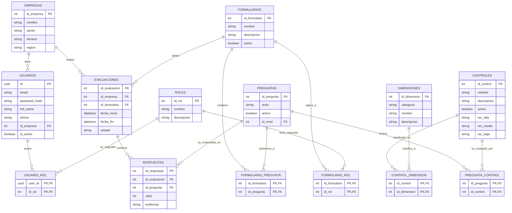

# MVP CIBERSECURITY


## Modelo Entidad-Relación (Diagrama de Clases)

A continuación se detalla la arquitectura de base de datos relacional para el sistema de ciber-madurez, reflejando el soporte completo a la ISO 27002 moderna y la escalabilidad de roles dinámicos.



# MVP Ciberseguridad

## 🚀 Cómo ejecutar el proyecto (Docker)

**Requisitos previos:**
* Tener instalado [Git](https://git-scm.com/downloads).
* Tener instalado [Docker Desktop](https://www.docker.com/products/docker-desktop/) (y asegurarse de que se está ejecutando).

**Paso 1: Clonar el repositorio**
```bash
git clone https://github.com/Santiard/MVP-CIBERSECURITY.git
cd MVP-CIBERSECURITY
```

**Paso 2: Levantar los contenedores**
```bash
docker-compose up --build
```
*(Nota: La primera vez puede tardar un par de minutos mientras descarga las imágenes).*

**Paso 3: Acceder a la aplicación**
Una vez que en la consola veas que los servicios están corriendo:
* **Aplicación web (Frontend):** [http://localhost:3001](http://localhost:3001)
* **Documentación de la API (Backend - Swagger):** [http://localhost:8000/docs](http://localhost:8000/docs)

**Paso 4: Detener la aplicación**
Presiona `Ctrl + C` en la terminal o ejecuta:
```bash
docker-compose down
```

---

## 🏗 Arquitectura
El proyecto implementa Arquitectura Limpia para garantizar separación de responsabilidades, independencia tecnológica y mantenibilidad.
El dominio encapsula la lógica de negocio (motor de madurez), la capa de aplicación orquesta casos de uso, infraestructura implementa persistencia y autenticación, y la capa de interfaces expone la API REST.

🔹 1️⃣ domain/

Aquí vive el corazón del sistema.
NO depende de Express, base de datos ni librerías externas.

Contiene:

Entidades (Organization, Evaluation, Questionnaire, Dimension)

Value Objects (Score, Level, Percentage)

Reglas de negocio

Interfaces (ports)

Ejemplo:

domain/
 ├── entities/
 ├── value-objects/
 ├── services/
 ├── repositories/


Aquí va el:

✔ Motor de scoring
✔ Lógica de cálculo de madurez
✔ Reglas como:

Una evaluación finalizada no se edita

Comparativa solo si hay 2 evaluaciones

💡 Esta capa no sabe que existe una base de datos.

🔹 2️⃣ application/

Orquesta los casos de uso.

Contiene:

Use Cases

DTOs

Validaciones de entrada

Coordinación entre dominio y repositorios

Ejemplo:

application/
 ├── use-cases/
 ├── dtos/


Ejemplos de casos de uso:

CreateEvaluation

CalculateScore

CompareEvaluations

GetEvaluationHistory

Esta capa dice:

“Quiero crear una evaluación”
“Necesito calcular el nivel”

Pero no sabe cómo se guarda en BD.

🔹 3️⃣ infrastructure/

Aquí vive la implementación técnica.

Contiene:

ORM (Prisma / TypeORM)

Implementación de repositorios

Conexión a base de datos

JWT

Servicios externos

Ejemplo:

infrastructure/
 ├── database/
 ├── repositories/
 ├── auth/


Aquí se implementa la interfaz que definiste en domain/repositories.

Si mañana cambias PostgreSQL por Mongo, solo modificas esta capa.

🔹 4️⃣ interfaces/

Es la capa más externa.

Contiene:

Controllers

Rutas

Middlewares

Mappers HTTP

Ejemplo:

interfaces/
 ├── controllers/
 ├── routes/
 ├── middlewares/


Aquí se conecta Express/NestJS con application.

📦 Frontend – Estructura profesional
src/
 ├── features/
 ├── components/
 ├── services/
 ├── hooks/
 ├── pages/
 ├── routes/

🔹 features/

Organización por funcionalidad, no por tipo.

Ejemplo:

features/
 ├── auth/
 ├── evaluation/
 ├── organization/
 ├── reports/


Cada feature contiene:

Componentes específicos

Servicios

Tipos

Hooks propios

Esto evita carpetas gigantes globales.

🔹 components/

Componentes reutilizables globales:

Button

Modal

Table

ChartContainer

🔹 services/

Comunicación con backend:

authService.ts

evaluationService.ts

Aquí se manejan llamadas HTTP.

🔹 hooks/

Hooks personalizados:

useAuth

useEvaluation

useCompare

🔹 pages/

Vistas principales:

LoginPage

DashboardPage

EvaluationPage

ReportPage

🔁 Flujo completo del sistema

Usuario → Controller → Use Case → Dominio → Repository → DB
↓
Motor Scoring

El dominio nunca depende de la base de datos.

🚀 ¿Por qué esto es ideal para tu MVP?

Aunque es MVP, tu proyecto:

Tiene reglas de negocio importantes

Debe ser demostrable académicamente

Debe escalar a investigación futura

Puede convertirse en producto real

Arquitectura Limpia te permite:

✔ Entregar MVP funcional
✔ Mantener profesionalismo
✔ Escalar a versión 2
✔ Agregar más normas ISO
✔ Convertirlo en SaaS futuro


Resumen Final del Stack

Frontend:

React + TypeScript

Tailwind

Recharts

Backend:

Node.js

NestJS

TypeScript

Prisma

PostgreSQL

JWT

Testing:

Jest

React Testing Library


CU-01 – Iniciar Sesión

Actor(es): Administrador, Evaluador, Organización
Descripción: Permite a un usuario autenticarse en el sistema mediante credenciales válidas.
Precondiciones:

El usuario debe estar previamente registrado.

La cuenta debe estar activa.

Postcondiciones:

El sistema crea una sesión activa.

Se redirige al panel correspondiente según el rol.

Flujo principal:

El actor ingresa correo y contraseña.

El sistema valida credenciales.

El sistema identifica el rol.

Se concede acceso al sistema.

Flujo alterno:

2a. Credenciales inválidas → Se muestra mensaje de error.

👥 CU-02 – Gestionar Usuarios

Actor: Administrador
Descripción: Permite administrar usuarios del sistema (crear, editar, desactivar y asignar roles).
Precondiciones:

El administrador debe estar autenticado.

Postcondiciones:

La información del usuario queda actualizada en el sistema.

Flujo principal:

El administrador accede al módulo de usuarios.

Selecciona acción (crear, editar o desactivar).

Ingresa o modifica información.

El sistema valida datos.

El sistema guarda cambios.

📋 CU-03 – Gestionar Cuestionarios

Actor: Administrador
Descripción: Permite crear y administrar cuestionarios, dimensiones y preguntas de evaluación.
Precondiciones:

Administrador autenticado.

Postcondiciones:

El cuestionario queda disponible para evaluación.

Flujo principal:

El administrador accede al módulo de cuestionarios.

Crea o edita dimensiones.

Agrega preguntas.

Activa cuestionario.

🏢 CU-04 – Gestionar Organizaciones

Actor(es): Administrador, Evaluador
Descripción: Permite registrar y actualizar información de organizaciones evaluadas.
Precondiciones:

Actor autenticado.

Postcondiciones:

Organización registrada o actualizada correctamente.

Flujo principal:

Actor accede al módulo organizaciones.

Selecciona registrar o editar.

Ingresa información requerida.

El sistema valida y guarda.

📝 CU-05 – Iniciar Evaluación

Actor: Evaluador
Descripción: Permite iniciar una nueva evaluación para una organización.
Precondiciones:

Evaluador autenticado.

La organización debe existir.

Debe existir un cuestionario activo.

Postcondiciones:

Se crea una evaluación en estado “En proceso”.

Flujo principal:

El evaluador selecciona organización.

Selecciona cuestionario activo.

El sistema crea evaluación.

Se habilita el formulario de respuestas.

📝 CU-06 – Registrar Respuestas

Actor: Evaluador
Descripción: Permite registrar las respuestas del cuestionario.

Precondiciones:

Evaluación en estado “En proceso”.

Postcondiciones:

Respuestas guardadas temporalmente.

Flujo principal:

El evaluador responde cada pregunta.

El sistema valida formato.

El sistema guarda respuestas.

🧮 CU-07 – Finalizar Evaluación

Actor: Evaluador
Descripción: Permite cerrar la evaluación y ejecutar el cálculo de madurez.

Precondiciones:

Todas las preguntas deben estar respondidas.

Postcondiciones:

Evaluación cambia a estado “Finalizada”.

Se calcula nivel de madurez.

Se almacenan resultados.

Flujo principal:

Evaluador selecciona “Finalizar evaluación”.

El sistema valida que no existan preguntas sin responder.

El sistema ejecuta cálculo de madurez.

El sistema guarda resultados.

Se genera reporte.

Relaciones:

<<include>> Calcular Madurez

<<include>> Guardar Evaluación

📊 CU-08 – Ver Reporte

Actor(es): Evaluador, Organización
Descripción: Permite visualizar el resultado de una evaluación.

Precondiciones:

Debe existir evaluación finalizada.

Postcondiciones:

Se muestran resultados gráficos por dimensión.

Flujo principal:

Actor accede a evaluación finalizada.

El sistema genera gráficos.

Se muestran niveles y porcentajes.

📈 CU-09 – Consultar Historial

Actor(es): Evaluador, Organización
Descripción: Permite visualizar evaluaciones anteriores.

Precondiciones:

Debe existir al menos una evaluación registrada.

Postcondiciones:

Se muestra lista histórica.

📊 CU-10 – Comparar Evaluaciones

Actor(es): Evaluador, Organización
Descripción: Permite comparar resultados entre evaluaciones históricas.

Precondiciones:

Deben existir mínimo dos evaluaciones.

Postcondiciones:

Se muestran variaciones porcentuales y evolución gráfica.

Flujo principal:

Actor selecciona dos evaluaciones.

El sistema calcula diferencias.

Se muestra comparativa gráfica.

Relación:

<<extend>> Consultar Historial
